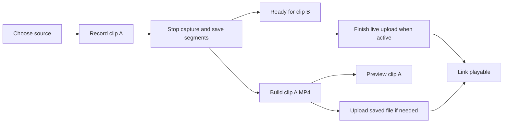

# Reel Mac Recorder Parity - Plan

## Goal Capsule

Make it easy to choose what Reel will record, see the camera and audio settings, and start another clip as soon as the previous capture releases its devices. Give each completed clip its own preview and sharing status.

Ship the capture handoff first as a tested Mac update. Ship window selection, the desktop toolbar, and the finished-clip card together once the native experience is verified. Use the public Reel repository and its existing Mac release path.

---

## Product Contract

### What Reel does today

1. **“Finishing…” has two meanings.** The menu uses that label for both preparing a new recording and stopping one. The Start command and recording shortcut are unavailable in both states. [Status menu](https://github.com/fortytwode/reel-open/blob/bcc8fbd/Sources/Reel/AppDelegate.swift#L281)
2. **Stop waits for the local export.** Reel stops screen and mic capture, closes the segment writer, assembles the MP4, reads its duration, and makes a thumbnail before Start returns. Upload and transcription can continue with the recorder already idle. Initial live-upload setup can delay **starting** a clip. Cancel and Restart can also wait for remote cleanup. [Recorder](https://github.com/fortytwode/reel-open/blob/bcc8fbd/Sources/Reel/RecorderController.swift#L393) · [Start](https://github.com/fortytwode/reel-open/blob/bcc8fbd/Sources/Reel/RecorderController.swift#L312)
3. **Window selection comes after Record.** Reel opens a scrollable thumbnail list, alphabetized within its on-screen and off-screen groups. “Record” can feel like it did nothing while the chooser is open in another window. The target only comes forward after recording starts. [Window picker](https://github.com/fortytwode/reel-open/blob/bcc8fbd/Sources/Reel/UI/WindowPicker.swift) · [Capture sequence](https://github.com/fortytwode/reel-open/blob/bcc8fbd/Sources/Reel/RecorderController.swift#L217)
4. **The desktop workflow is split up.** Reel already has four capture modes, a camera preview, an input meter, a floating bar during capture, and library actions afterward. Loom makes the source and device choices visible on the desktop before Record. The screenshots also show the value of immediate Preview, Open, and Copy link actions after Stop. [Reel recorder panel](https://github.com/fortytwode/reel-open/blob/bcc8fbd/Sources/Reel/UI/RecorderPanel.swift#L30) · [Loom desktop workflow](https://support.atlassian.com/loom/docs/get-started-with-loom-for-macos/)

**Incident evidence.** On installed Reel 1.2.20 (188), the nearby 52-second recording had saved its MP4 and thumbnail at 16:17:05 CET. The local log did not identify the operation behind the 16:20:38 screenshot. Public main `bcc8fbd` includes 1.2.21 publisher ownership changes and still has the same recorder gate and picker behavior.

### Requirements

- R1. After Stop, make the recorder available as soon as capture is released and the playable media can be safely recovered. Show **Preparing recorder** or **Stopping capture** during those brief operations. Show **Saving video**, **Uploading**, and errors on the clip they belong to. A slow upload, thumbnail, or transcription must never take away Start.
- R2. Select the source before Record. For a visible window, make it clear which window will be captured and allow a direct selection when macOS supports it. Offer a searchable keyboard-accessible window list. If the target vanishes, ask for a new window and leave the recorder ready.
- R3. Use one compact Reel toolbar on the desktop for Display, Window, Area, and Camera. Show the selected target, current camera and mic, input activity, and Record. Keep system audio and secondary settings within easy reach. Keep the timer, pause, and stop visible during capture.
- R4. After Stop, offer **Record next**, **Preview** when the local file is playable, and **Open link** and **Copy link** when sharing is available. Show the clip's sharing state and put rename, trim, and sharing settings in **More**. Surface upload failures and retry on the old clip. Use the existing access rules, publisher checks, and explicit confirmation for sharing a meeting video.

---

## Planning Contract

- **Capture and saving have different lifetimes.** One take owns screen, mic, camera and write callbacks until they are safely stopped. After the segment log is durable, release the recorder and queue MP4 assembly, duration, thumbnail and follow-up by recording ID. Keep local exports bounded and atomically publish the finished MP4. Verify segment and end-log writes before claiming a complete take. If either fails, preserve usable segments and surface the incomplete save. Device readiness can recover once capture is safely stopped. Update the latest manifest's capture fields without overwriting concurrent upload or share updates. Carry recording ID and ownership into late callbacks, and prevent discarded takes from being published by a late job.
- **Local capture starts on local readiness.** Permission, a valid source, device readiness and the user's countdown determine when capture can begin. Attach live upload off the critical path using the segment log to reconcile early frames, or use the existing post-Stop upload path for that take. Handle a hung capture teardown with a visible recovery path and release the devices only once they are actually safe to reuse.
- **Try the macOS picker first.** Validate single-window selection from the toolbar, actual desktop selection behavior, and source identity through countdown. Apple's picker supplies an `SCContentFilter`. Reel currently consumes an `SCWindow`, and the SDK's `includedWindows` property requires macOS 15.2. Keep Reel's macOS 15.0 minimum. Where the native path cannot offer a verified click-to-select flow, reuse the area overlay for highlighting and selecting a visible capture candidate. Keep the searchable list available for keyboard use and windows on other Spaces. Reject stale picker callbacks and lock the source to the confirmed window during capture. A browser window capture includes tab changes within that window. [Apple picker documentation](https://developer.apple.com/documentation/screencapturekit/sccontentsharingpicker) · [Apple direct window selection demo](https://developer.apple.com/videos/play/wwdc2023/10136/)
- **Keep the next take in view.** Reuse Reel's camera preview, microphone meter, saved device choices, and existing clip actions in a visually distinct toolbar and card. Keep preview and recording controls out of the video. Respect the user's saved automatic link behavior. Put new clip actions in the card so the browser need only open when requested or explicitly configured.

---

## Implementation Units

### U1. Make consecutive recordings reliable

**Covers R1.** Start with timestamps for Stop, device release, writer close, ready for next, local playback, and link playback. Move local assembly out of the capture gate and remove remote initialization and cleanup from Start and Restart. Reuse recovery for incomplete outputs, and preserve per-recording CLI completion callbacks.

**Files** `Sources/Reel/RecorderController.swift`, `Sources/Reel/Capture/RecordingSession.swift`, `Sources/Reel/Capture/SegmentedWriter.swift`, `Sources/Reel/Processing/PostProcessor.swift`, `Sources/Reel/AppModel.swift`, `Sources/Reel/AppDelegate.swift`, `Sources/Reel/Recovery.swift`, `Sources/Reel/Publisher.swift`, `Sources/Reel/CLI.swift`, and `Tests/ReelCoreTests/CaptureFeatureTests.swift`.

**Verify** Stop followed immediately by another take while old export and upload are slow or offline. Exercise paused capture, Cancel and Restart with slow remote cleanup, forced quit after Stop, disk-full failures during writer close and export, and an account switch with an older upload in progress. Check that both healthy recordings play back with the right audio, frames, and ownership. Compare time to next-ready with time to local playback and time to link.

### U2. Choose and confirm the exact window

**Covers R2.** Run the native-picker check on macOS 15 and the currently supported macOS release. Resolve the confirmed window before Start and keep it visible in the toolbar. In the list, prioritize visible windows, group by app, and search by title or app. Show previews without waiting for all thumbnails. Keep the list accessible from the toolbar and keyboard.

**Files** `Sources/Reel/UI/WindowPicker.swift`, `Sources/Reel/UI/AreaSelector.swift`, `Sources/Reel/Capture/ScreenCapture.swift`, `Sources/Reel/RecorderController.swift`, and `scripts/tests/WindowPickerSmoke.swift`.

**Verify** Two overlapping windows of the same app, a window on a second display or Space, a minimized window, Escape, keyboard selection, and closing the selected window during countdown. Simulate a late selection after cancellation and a source change during a take. Inspect recorded frames for the correct window and for the absence of adjacent windows. Exercise consent and permission denial.

### U3. Polish the recorder and the finished-clip card

**Covers R3–R4.** Build on U1 readiness and U2 source selection. Consolidate the controls into a lightweight desktop toolbar, with a movable camera preview when enabled. Put each finished clip's local and sharing actions in one dismissible card that can stay visible while another capture starts. Reuse Library and Publisher actions.

**Files** `Sources/Reel/UI/RecorderPanel.swift`, `Sources/Reel/UI/ControlBarWindow.swift`, `Sources/Reel/UI/BubbleWindow.swift`, `Sources/Reel/UI/LibraryView.swift`, `Sources/Reel/AppDelegate.swift`, and `Tests/ReelCoreTests/SharingTests.swift`.

**Verify** Light and Dark appearance, compact displays, multiple displays, keyboard and VoiceOver, devices denied or disconnected, local-only and protected links, upload retry, and private meeting video sharing. Check the finished clip and the next recording simultaneously.

---

## Verification Contract

- Run `swift test` and the Window Picker smoke checks. Use the existing recorder CLI and an isolated native QA account or fixture to validate the two-take sequence. Record harmless windows and inspect the output files.
- Proposed performance target is next-ready within one second at p95 on healthy local devices after Stop, measured across at least 20 short takes and checked against several long takes. Measure the current build first. Track local playback and link readiness separately. Exercise slow export and offline capture irrespective of the numeric target.
- Confirm the desktop walkthrough on a signed build. Verify the start sequence from the menu bar, keyboard shortcut and Screen recordings, and run a meeting capture regression for automatic/manual permissions and delivery.

---

## Definition of Done

The installed build can make consecutive independently playable clips while the previous clip finishes. A window is unambiguous before capture begins. Camera and audio choices are visible, and preview and sharing actions describe the right clip. Capture failure and recovery are verified with retained segments, and the signed Mac update ships only after the native walkthrough passes.
